# 学研智擎 DisciMind 产品需求规格说明书

## 1. 文档信息

| 项目 | 内容 |
|---|---|
| 项目中文全称 | 学研智擎——面向一流学科建设的垂类大模型教学科研创新应用平台 |
| 英文名称 | DisciMind |
| 文档类型 | 产品需求规格说明书，融合 PRD 与 SRS |
| 文档版本 | V1.0 |
| 编写日期 | 2026-07-07 |
| 样板课程 | 机器学习 |
| 目标课程范围 | 机器学习、软件工程、计算机科学与技术、网络工程、大数据、人工智能及其他计算机大类课程 |
| 核心角色 | 学生、教师、管理员 |
| 编写依据 | 五份需求文档、当前项目目录与代码、数据库 Schema、官方政策与 AI 治理资料 |
| 输出位置 | `docs/DisciMind-产品需求规格说明书.md` |

本文档用于统一“学研智擎 DisciMind”的产品目标、业务规则、功能范围、权限边界、技术架构、数据关系、验收标准与 15 天实施计划。本文档描述完整产品目标，不把需求压缩为当前代码状态，也不把早期设想机械拼接为功能堆叠。


## 2. 执行摘要

学研智擎 DisciMind 是面向计算机大类学科建设的教学、学习与科研一体化垂类大模型平台。平台以“机器学习”课程作为首个完整样板课程，通过多层知识库、RAG 可信问答、多 Agent 协同、学生自定义学习工作流、教师智能备课、Agent 广场、知识图谱、错题强化和学习画像，构建从知识资源沉淀到个性化学习，再到教师教学反馈的完整闭环。

本系统不是普通课程管理平台，也不是只提供聊天窗口的大模型应用。其产品主线是 Agent。知识库和 RAG 是可信基础，学生自定义学习工作流是当前版本的核心创新，教师多 Agent 备课系统是教师侧核心创新，智能体广场是 Agent 能力共享和低门槛创建的载体。课程、知识图谱、错题、画像、练习和教学分析都必须与 Agent 主线关联，而不是彼此独立。

平台围绕四个一级痛点展开：

1. 传统学习系统个性化程度低。
2. AI 回复内容可信度低。
3. 信息碎片化、文件和知识资源不统一。
4. 缺少 AI 深度辅助，学习与教学效率低。

平台重点形成三项核心技术成果：

1. 多 Agent 协同的学生自定义学习工作流与教师备课系统。
2. 强可溯源、高可信度 AI 对话系统。
3. AI Agent 智能体广场和低门槛 Agent 创建。

当前项目代码采用前后端分离架构。前端是 Vite、JavaScript ES Module、HTML5、CSS3、Axios、ECharts，并已引入 DOMPurify、Marked、KaTeX、Mind Elixir 等依赖；后端是 Node.js、Express、Prisma、MySQL，并使用 JWT、bcryptjs、multer、pdf-parse、mammoth、OpenAI SDK 等依赖；AI 侧已有 DeepSeek 流式对话、AI 题目生成、错题变式生成等服务代码，同时预留 Dify、RAG、Agent、Agent 广场、自研调度器和多模型 Provider 目录。数据库已覆盖用户、行政班、教学班、课程、知识点、知识库、文档、对话、来源、题库、任务、答题、错题、画像、推荐、视频、通知、日志和 AI 配置等核心实体。

## 3. 项目背景

### 3.1 政策背景

国家持续推进教育数字化和人工智能赋能教育。《教育强国建设规划纲要（2024—2035年）》提出实施国家教育数字化战略，促进人工智能助力教育变革；教育部等九部门《关于加快推进教育数字化的意见》强调以教育数字化支撑教育强国建设，推进集成化、智能化和国际化；2026 年教育部等五部门印发的《“人工智能+教育”行动计划》进一步将人工智能深度融入教育教学、科研创新和治理能力建设。

教育场景中的 AI 应用与普通娱乐场景不同，它面向真实学习行为、课程资料、学生画像和教师决策，天然具有可信、可控、可解释、可追溯和隐私保护要求。UNESCO 关于生成式人工智能在教育与研究中的指导强调以人为本、保护学习者权益并提升教师与学习者能力；NIST AI RMF 将可信 AI 归纳为有效可靠、安全、稳健、可问责透明、可解释、隐私增强与公平等特征。这些要求共同说明，高校教学 AI 平台不能只追求生成能力，还必须建立来源、权限、人工确认、风险提示和审计机制。

### 3.2 行业背景

高校数字系统长期存在资源分散、平台割裂、数据沉睡和反馈滞后的问题。课程讲义、教材、实验指导、题库、论文、项目材料、教学方案、学生笔记和课堂问题分布在网盘、群聊、学习平台、教师电脑和个人文件夹中。通用大模型虽然提升了问答和内容生成效率，但若不接入课程知识库和权限上下文，容易出现回答无依据、来源不可查、课程适配不足和隐私边界不清的问题。

一流学科建设需要长期积累课程资源、学科资料、教学数据、学生成长证据和科研辅助材料。单点工具无法支撑这类持续沉淀，系统必须把知识资产管理、AI 问答、学习过程、教师反馈和管理治理放在同一业务闭环中。

### 3.3 现实背景

当前项目以机器学习课程为样板课程。机器学习课程具备知识点层级清晰、公式推导较多、算法案例丰富、实验训练明显、错题与掌握度可量化等特点，适合完整验证知识图谱、RAG 答疑、练习测试、错题强化、学习画像、学生学习流和教师备课反馈。

系统设计不能写死为机器学习专用。课程、知识点、题库、知识库、Agent 类型、教学班和学习画像都应支持扩展到软件工程、计算机网络、数据库、操作系统、大数据、人工智能等计算机大类课程。

## 4. 项目痛点

### 4.1 个性化程度低

传统学习系统通常按照统一顺序、统一内容和统一节奏组织课程。学生只能被动接受章节安排，很难根据自己的认知习惯调整学习路径。有的学生适合先做题再理解概念，有的学生适合先看例题再学习理论，有的学生需要先补薄弱点再进行完整训练。传统系统即使记录了学习画像、错题、掌握度和推荐内容，也很少真正让这些数据参与学习流程。

由此推导出学生自定义学习工作流和多 Agent 协同学习系统。学生可以基于画像、薄弱点、错题状态和课程进度，自主拖拽学习节点，形成“先练后学型”“先学后练型”“例题驱动型”“冲刺复习型”等个性化流程。

### 4.2 AI 回答可信度低

通用模型容易出现幻觉，回答来源不清，学生无法判断答案是否来自课程教材或权威资料，教师也不愿直接使用无法验证的 AI 内容。数学公式、代码解释、算法定义、实验结论和课程考点尤其需要依据。

由此推导出多层知识库、RAG 检索增强生成、来源文件、页码、原文片段、相似度和点击查看原文组成的强可溯源 AI 对话系统。当没有可靠来源时，系统必须明确提示“该回答未基于知识库”，不得伪装成有来源回答。

### 4.3 信息碎片化与文件不统一

课程讲义、教材、PPT、习题、实验资料、个人笔记和教师资料分散在不同文件夹、聊天工具和平台中。资源难以形成统一检索入口，也难以构建课程知识结构，更难复用为 Agent 和教学分析的数据基础。

由此推导出多层知识库、文件解析、课程知识图谱和知识资产统一管理。知识库既要服务问答，也要服务教学班、课程空间、Agent 创建、学习流节点执行和教师备课分析。

### 4.4 缺少 AI 深度辅助导致效率低

很多 AI 教学应用仍停留在单轮问答，不能参与完整学习过程。错题、练习、概念讲解、学习总结、学习报告、课堂备课和教学材料生成相互割裂。教师仍需手动整理班级问题、设计教案、制作测试和分配作业，学生行为数据不能快速转化为下一步学习任务。

由此推导出学生多 Agent 学习流和教师多 Agent 备课系统。学生侧强调“学习节点可编排、Agent 按节点执行、数据回写画像”；教师侧强调“班级数据分析 Agent、教学助手 Agent、文档生成 Agent 固定协作，并由教师审核后发布”。

## 5. 项目定位与目标

### 5.1 项目定位

学研智擎 DisciMind 定位为面向计算机大类学科建设的教学科研一体化垂类大模型平台。平台围绕专业课程资料、教学班数据、学生学习过程和教师教学改进构建垂直知识底座，利用 RAG、Agent、知识图谱、学习画像和多角色权限治理，为高校课程建设、专业建设和一流学科建设提供可持续沉淀的智能平台。

### 5.2 总体目标

1. 建立多层知识库体系，统一接入课程资料、学科建设材料、题库、个人笔记和 Agent 专属资料。
2. 建立可信 AI 对话系统，支持通用问答、学科答疑和 Agent 对话三个工作空间。
3. 建立学生自定义学习工作流，使学习画像、错题状态、掌握度和课程进度直接参与学习流程。
4. 建立教师多 Agent 备课系统，把班级聚合数据转化为教学目标、重点难点、复习清单、PPT 大纲、随堂测试和作业。
5. 建立 Agent 广场，使教师和学生能够低门槛创建、使用、复制、收藏、评分和分享 Agent。
6. 建立管理员治理体系，支撑用户、角色、课程、行政班、教学班、知识库、文件、Agent、模型配置、日志和公告管理。

### 5.3 样板课程与扩展原则

机器学习作为样板课程用于完整验证。正式数据结构和功能文案不得将课程、Agent、知识图谱和题库写死为机器学习专用。系统应通过课程、章节、知识点、教学班和知识库的配置，支持扩展到计算机大类其他课程。

## 6. 核心技术成果

### 6.1 学生多 Agent 自定义学习工作流

学生可以通过可视化拖拽方式自主编排学习流程。这里拖拽的是学习节点，不是底层 API 节点、模型路由节点或通用 Agent 技术节点。

可用学习节点至少包括：学习目标设定、章节导入、知识点概览、概念讲解、例题引入、例题分析、视频学习、题目练习、随堂测试、错题诊断、原题重做、AI 变式题训练、AI 相似题训练、学科答疑、阶段总结、学习报告和下一步推荐。

| 学习节点 | 执行 Agent 或服务 |
|---|---|
| 概念讲解 | 概念讲解 Agent |
| 例题分析 | 例题解析 Agent |
| 题目练习 | 出题 Agent 与练习服务 |
| 错题诊断 | 错题分析 Agent |
| 变式训练 | 变式题生成 Agent |
| 相似题训练 | 相似题生成 Agent |
| 阶段总结 | 总结 Agent |
| 学习推荐 | 学习路径规划 Agent |
| 视频学习 | 视频推荐或视频讲解 Agent |
| 学科答疑 | 学科知识库问答 Agent |

典型学习模式如下：

| 模式 | 节点顺序 |
|---|---|
| 先练后学型 | 章节测试 -> 错题分析 -> 概念讲解 -> 相似题训练 -> 阶段总结 |
| 先学后练型 | 知识点概览 -> 概念讲解 -> 例题引入 -> 题目练习 -> 错题复盘 |
| 例题驱动型 | 例题展示 -> 解题思路分析 -> 关联概念讲解 -> 同类题训练 |
| 冲刺复习型 | 薄弱知识点识别 -> 高频错题重做 -> 难题训练 -> 模拟测试 |

学习流必须与学生画像、知识点掌握度、错题状态、课程进度、最近提问、学习时长、任务完成情况和历史学习流偏好联动。闭环为：

学生画像 -> 推荐学习流 -> 学生编辑或自主创建 -> 多 Agent 按节点执行 -> 生成学习数据 -> 更新错题、进度和画像 -> 调整下一次学习流。

当前版本的学习流是面向学习节点的拖拽式编排，不是 Dify 类底层工作流编辑器。条件分支、循环节点、模型路由、工具节点、自定义 API 和通用底层 Agent 编排作为远期能力。

### 6.2 教师多 Agent 备课系统

教师侧采用固定协作流程，不要求教师拖拽底层工作流。核心流程为：

班级数据分析 Agent -> 教学助手 Agent -> 文档生成 Agent -> 教师审核编辑 -> 输出并发布。

数据分析 Agent 输入至少包括单门课程下的学科答疑高频 Tag、知识点提问人数、班级知识点掌握度、题目错误人数、章节错误率、学习时长、登录频率、任务完成记录和课程学习进度。

教师不查看学生提问原文。系统只能从“学科答疑”工作空间中提取关键词、知识点标签、高频 Tag、提问次数、关联章节和时间趋势。教师工作流输出至少包括下节课教学目标、重点与难点、班级薄弱知识点、复习清单、课堂讲授顺序、课堂活动建议、PPT 大纲、随堂测试、课后作业和个性化教学建议。所有生成结果必须经过教师人工确认才能发布。

### 6.3 强可溯源 AI 对话系统

AI 对话一级导航聚合三个工作空间：

| 工作空间 | 定位 | 知识库绑定 | 是否进入教学分析 | 隐私规则 |
|---|---|---|---|---|
| 通用问答 | 默认进入，用于通用学习问题 | 不强制绑定知识库，可使用通用模型 | 不进入 | 默认隐私 |
| 学科答疑 | 与具体课程绑定，优先使用课程知识库 | 绑定课程知识库 | 进入 | 页面提示相关提问信息可能用于课程教学分析，教师不能看原文 |
| Agent 对话 | 与用户选择的 Agent 绑定 | 根据 Agent 配置使用一个或多个知识库 | 不进入 | 支持历史、来源和上下文，按 Agent 权限访问 |

RAG 回答流程必须包含：

用户问题 -> 意图与实体识别 -> 按权限和知识库优先级检索 -> Dify 检索与召回 -> 上下文组装 -> 大模型生成 -> 来源解析 -> 回答与来源共同展示 -> 用户反馈。

来源展示至少包括文件名称、页码或位置、原文片段、相似度、知识库名称、点击查看原文和命中内容高亮。一个 Agent 可以关联多个知识库，并设置检索优先级。

公开 Agent 的使用者可以查看知识库名称、文件列表、回答引用到的原文和原始文件内容；不可以下载知识库原始文件、修改原知识库、删除原知识库或修改原 Agent 配置。

当 RAG 没有检测到可靠来源时，允许使用通用模型继续回答，但必须醒目标注“该回答未基于知识库”。多个来源冲突时，模型应展示主要观点差异，分析来源权威性、发布时间、资料类型和上下文，并说明最终采用哪一观点及原因。AI 基于已有资料自行推导出的部分，需要标注“此部分内容由 AI 基于已引用资料推导生成”。问候、功能操作指导和非知识性对话无需来源。

### 6.4 Agent 广场与低门槛创建

Agent 创建流程应尽量简单：

填写名称与描述 -> 选择 Agent 类型 -> 选择一个或多个知识库 -> 设置知识库检索优先级 -> 设置可见范围 -> 一键创建。

Agent 类型至少包括课程问答 Agent、概念讲解 Agent、出题 Agent、错题诊断 Agent、学习路径 Agent、学习分析 Agent、教学助手 Agent、数据分析 Agent、文档生成 Agent、视频讲解 Agent 和科研辅助 Agent。科研辅助作为后续增强能力，不与当前三项核心成果争夺主线。

用户需要支持创建、编辑、删除、发布、下架、直接使用、复制到个人工作空间、收藏、匿名评分、搜索、筛选、查看使用次数、查看创建者和查看知识库概要。

发布规则如下：

| 场景 | 审核规则 |
|---|---|
| 教师创建并公开 Agent | 可以直接公开，管理员保留治理和下架权 |
| 学生创建且仅个人可见 Agent | 不需要审核 |
| 学生创建并希望公开或共享 Agent | 必须审核 |
| 违规 Agent | 管理员可撤回、下架、记录原因并通知创建者 |

一键使用分为两种模式：

| 模式 | 规则 |
|---|---|
| 直接使用原 Agent | 使用者不获得独立副本；创建者更新后同步获得更新；原 Agent 下架后使用者不可继续使用；使用记录保留 |
| 复制到个人工作空间 | 形成独立副本；后续不再跟随原 Agent 更新；原 Agent 下架后副本仍可使用；副本创建者可继续编辑；不得自动复制无权限下载的原始文件 |

## 7. 用户角色与权限

### 7.1 核心角色

系统包含学生、教师和管理员三类核心角色。后续可预留学科专家、教学秘书和知识库审核员，但当前主需求仍以三角色为核心。

| 角色 | 核心目标 | 典型行为 |
|---|---|---|
| 学生 | 个性化学习、可信问答、练习与复习、Agent 使用和创建 | 登录、进入课程、查看知识图谱、创建学习流、答疑、做题、查看错题和画像、使用 Agent 广场 |
| 教师 | 数据驱动教学、课程与教学班管理、知识库建设、备课与发布 | 管理课程、导入学生、上传资料、查看看板、生成教学方案、发布任务和通知 |
| 管理员 | 平台治理、安全审计、资源审核、配置管理 | 管理用户、角色、行政班、教学班、课程、知识库、公开 Agent、模型配置、日志和公告 |

### 7.2 权限矩阵

| 对象或能力 | 学生 | 教师 | 管理员 |
|---|---|---|---|
| 本人课程与教学班 | 查看 | 查看所负责范围 | 管理 |
| 本人画像 | 查看 | 查看授权课程下学生画像详情 | 不默认查看个体学习内容 |
| 其他学生画像 | 不可查看 | 可查看所负责教学班学生画像 | 按治理需要查看聚合，不默认查看明细 |
| 本人错题 | 查看、重做、标记 | 不查看完整个人错题本 | 不默认查看 |
| 题目维度错题分析 | 查看本人相关 | 查看题目错误人数和错误答案 | 管理统计 |
| 通用问答正文 | 仅本人 | 不可查看 | 不默认查看 |
| 学科答疑原文 | 仅本人 | 不可查看原文，只看 Tag、关键词、知识点、提问人数和趋势 | 不默认查看 |
| Agent 对话正文 | 仅本人 | 不可查看学生 Agent 对话正文 | 不默认查看 |
| 个人知识库 | 创建、查看、删除 | 不可查看学生私有内容 | 不默认查看 |
| 课程知识库 | 查看授权内容 | 创建、管理所负责课程 | 审核与治理 |
| 公开知识库 | 查看授权内容 | 发布与管理本人内容 | 审核、下架、删除违规内容 |
| Agent 创建 | 个人创建，公开需审核 | 创建，公开可直接发布 | 审核、下架、治理 |
| 模型配置 | 不可操作 | 不可操作 | 管理 |
| 审计日志 | 不可查看 | 查看本人和课程相关必要记录 | 管理 |

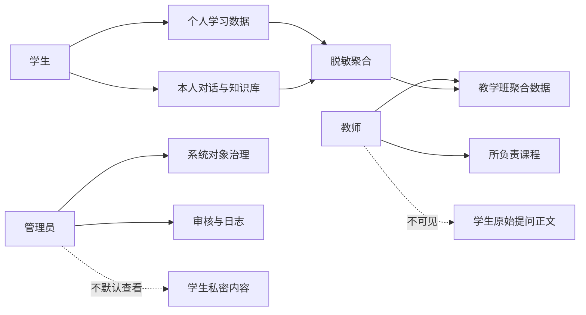

### 7.3 隐私边界

学生可查看本人课程、本人教学班、本人画像、本人错题、本人历史对话、本人知识库、本人 Agent 以及已授权公开知识库和 Agent。学生不可查看其他学生画像、其他学生原始提问、其他学生完整错题、教师管理数据和管理员配置。

教师可查看所负责课程、所负责教学班、班级聚合数据、单个学生详细画像、单个学生知识点掌握度、学习时长、登录频率、任务完成记录以及以题目为中心的错误学生和错误答案。教师不可查看学生通用问答内容、学生 Agent 对话内容、学生学科答疑原文、学生完整个人错题本和无授权课程数据。

管理员可管理用户、角色、行政班、教学班、课程、知识库、文件、Agent、模型配置、审核、系统日志、公告和运行状态。管理员不默认查看学生私密对话正文、学生通用问答正文、学生 Agent 对话正文和教学无关个人内容。

## 8. 总体业务架构

```mermaid
flowchart TB
    P["学研智擎 DisciMind"] --> Common["共有基础能力"]
    P --> Student["学生端"]
    P --> Teacher["教师端"]
    P --> Admin["管理员端"]
    P --> AgentLayer["Agent 层"]
    P --> RagLayer["知识库与 RAG 层"]
    P --> DataLayer["数据层"]

    Common --> Auth["登录注册与会话"]
    Common --> Message["消息通知"]
    Common --> Search["搜索、收藏、历史、反馈"]
    Common --> File["文件上传"]

    Student --> S1["课程学习中心"]
    Student --> S2["知识图谱"]
    Student --> S3["自定义学习工作流"]
    Student --> S4["练习、考试、错题"]
    Student --> S5["学习画像与推荐"]

    Teacher --> T1["课程与教学班管理"]
    Teacher --> T2["题库与任务发布"]
    Teacher --> T3["班级数据看板"]
    Teacher --> T4["多 Agent 备课"]
    Teacher --> T5["教学材料生成"]

    Admin --> A1["用户与角色"]
    Admin --> A2["课程与班级治理"]
    Admin --> A3["知识库与文件审核"]
    Admin --> A4["Agent 治理"]
    Admin --> A5["模型配置与日志"]

    AgentLayer --> AG1["课程问答 Agent"]
    AgentLayer --> AG2["学习类 Agent"]
    AgentLayer --> AG3["教师备课 Agent"]
    AgentLayer --> AG4["Agent 广场"]

    RagLayer --> KB["多层知识库"]
    RagLayer --> RAG["检索增强生成"]
    RagLayer --> SRC["来源追溯"]

    DataLayer --> DB["MySQL 业务数据"]
    DataLayer --> FS["本地文件存储"]
    DataLayer --> Dify["Dify 知识库与工作流"]
```

## 9. 数据与业务关系

### 9.1 行政班级

行政班级表示高校学生基础组织关系。一个学生属于一个行政班级，行政班主要用于学生基础信息、学院、专业、年级和行政归属管理。行政班不等同于课程教学班。

### 9.2 教学班

教学班表示一门课程在某学期的教学组织。一个教学班关联一门课程，可以包含来自多个行政班级的学生。一名学生可以加入多门课程的多个教学班。一个教学班可以由一名或多名教师负责。

学生加入教学班支持管理员批量导入、教师批量导入、邀请码加入、学生申请并由教师审核。学生不能自行退出教学班。学生被教师或管理员移出教学班后，按照当前业务规则，该教学班内的历史学习记录不继续保留。删除或解除关系影响范围包括教学班学习进度、课程任务记录、班级分析记录、教学班错题统计、教学班画像关联和教学班消息。

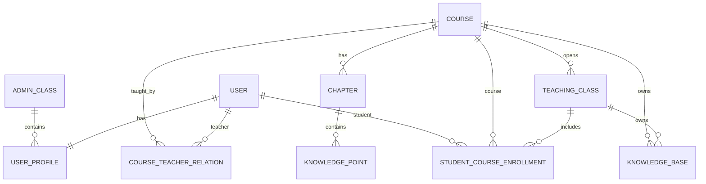

### 9.3 课程与教师

一门课程可以开设多个教学班；一名教师可以教授多门课程；一门课程可以由多名教师共同负责；一个教学班可以由一名或多名教师负责。学生通过教学班获得课程学习权限。行政班主要服务基础组织关系，教学班主要服务课程教学、任务发布和学情分析。

### 9.4 三角色业务关系图

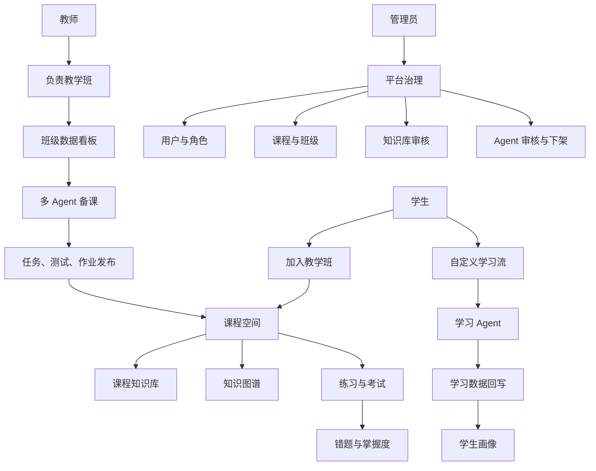

## 10. 共有功能需求

共有基础能力先统一定义，避免在学生端、教师端和管理员端重复描述。

### 10.1 共有功能清单

| 编号 | 功能名称 | 使用角色 | 目标 |
|---|---|---|---|
| FR-AUTH-001 | 注册 | 学生、教师 | 支持账号创建、身份选择和基础资料填写 |
| FR-AUTH-002 | 登录与角色跳转 | 学生、教师、管理员 | 登录后按角色进入对应工作台 |
| FR-AUTH-003 | 会话管理 | 学生、教师、管理员 | 支持 JWT 鉴权、Refresh Token、会话失效和退出登录 |
| FR-AUTH-004 | 找回密码与修改密码 | 学生、教师、管理员 | 提供安全的密码恢复与更新 |
| FR-PROFILE-001 | 个人资料与头像 | 学生、教师、管理员 | 维护实名资料、头像、学院、专业、工号或学号 |
| FR-NOTICE-001 | 消息通知 | 学生、教师、管理员 | 支持系统、课程、任务、审核、解析、Agent 上下架通知 |
| FR-FILE-001 | 文件上传 | 学生、教师、管理员 | 按权限上传课程、个人或治理文件 |
| FR-KB-001 | 知识库基础操作 | 学生、教师、管理员 | 创建、编辑、删除、上传、解析、查看状态 |
| FR-AI-001 | AI 对话基础能力 | 学生、教师、管理员 | 支持多轮对话、历史、反馈和异常提示 |
| FR-MARKET-001 | Agent 广场基础使用 | 学生、教师、管理员 | 搜索、筛选、查看、收藏、直接使用和复制 Agent |
| FR-SEARCH-001 | 搜索与历史 | 学生、教师、管理员 | 支持会话、知识库、Agent、课程和任务搜索 |
| FR-FEEDBACK-001 | 用户反馈 | 学生、教师、管理员 | 对回答、Agent、文件和页面异常提交反馈 |

### 10.2 共有功能规格表

| 功能编号 | 功能名称 | 所属模块 | 使用角色 | 功能目标 | 前置条件 | 触发方式 | 输入 | 主流程 | 分支流程 | 异常流程 | 输出 | 数据记录 | 权限规则 | 页面交互 | 验收标准 |
|---|---|---|---|---|---|---|---|---|---|---|---|---|---|---|---|
| FR-AUTH-001 | 注册 | 共有 | 学生、教师 | 建立用户身份和基础资料 | 用户未登录 | 注册页提交 | 用户名、密码、角色、姓名、学号或工号、联系方式 | 校验字段、加密密码、创建用户和资料、返回登录入口 | 教师注册可进入待审核或直接启用策略 | 用户名重复、密码弱、字段缺失、服务异常 | 注册结果 | User、UserProfile、OperationLog | 不允许注册管理员；角色不可越权 | 密码强度提示、确认提交、错误提示 | 学生和教师可完成注册，密码加密存储，重复账号被拒绝 |
| FR-AUTH-002 | 登录与角色跳转 | 共有 | 全部 | 让用户进入对应角色工作台 | 已有有效账号 | 登录页提交 | 用户名、密码 | 校验密码、生成 Access Token、写入 Refresh Token、返回用户信息 | 禁用账号显示禁用原因 | 密码错误、账号不存在、会话创建失败 | 用户信息与首页路由 | AuthSession、RefreshToken、last_login_at | 学生到学生工作台，教师到教师工作台，管理员到后台 | 加载态、错误态、自动跳转 | 三角色登录后进入正确页面，无权限访问自动回首页 |
| FR-AUTH-003 | 会话管理 | 共有 | 全部 | 保持安全会话并支持失效 | 已登录 | 页面请求、刷新、退出 | Token、Cookie、设备与 IP | 校验 JWT、刷新令牌、续期或退出 | 空闲超时触发重新登录 | Token 过期、Refresh Token 撤销、跨站来源异常 | 会话状态 | AuthSession、RefreshToken | 仅本人可刷新本人会话 | 静默刷新、登录失效提示 | Token 过期后可刷新，Refresh 失效后需重新登录 |
| FR-PROFILE-001 | 个人资料与头像 | 共有 | 全部 | 维护个人展示与身份资料 | 已登录 | 个人资料页 | 姓名、性别、学院、专业、头像文件 | 读取资料、编辑字段、上传头像、保存 | 头像可裁剪或重新上传 | 文件过大、格式不合法、无权限 | 更新后的资料 | UserProfile、文件存储 | 仅本人可编辑本人资料，管理员可治理基础账号 | 表单校验、上传进度、成功提示 | 修改后页面展示一致，非法图片被拒绝 |
| FR-NOTICE-001 | 消息通知 | 共有 | 全部 | 统一承载系统和业务通知 | 已登录 | 导航栏、通知中心 | 通知类型、接收人、目标对象 | 拉取通知、展示未读、标记已读 | 管理员和教师可创建通知 | 通知不存在、无权限、已删除 | 通知列表与未读数 | Notification | 只能查看发给自己的通知；管理员管理公告 | 红点、未读数量、空状态 | 发布后目标用户可见，已读状态正确 |
| FR-KB-001 | 知识库基础操作 | 共有 | 全部 | 支撑资料沉淀和 RAG 检索 | 已登录且有对象权限 | 知识库页面 | 名称、层级、课程、教学班、文件 | 创建知识库、上传文档、解析、查看状态 | 个人、课程、教学班、平台层级不同 | 文件格式不支持、解析失败、无权限 | 知识库和文档状态 | KnowledgeBase、KnowledgeDocument、KnowledgeDocumentChunk | 按拥有者、课程、教学班和审核状态过滤 | 上传进度、解析状态、失败重试 | 上传 PDF 或 Word 后显示状态，失败可重试 |
| FR-AI-001 | AI 对话基础能力 | 共有 | 全部 | 支持多轮 AI 交互 | 已登录 | AI 对话入口 | 问题、空间、课程、Agent、附件 | 创建会话、保存消息、调用模型、返回回答 | 非知识性对话可无来源 | 模型失败、超时、敏感内容、无来源 | 回答、来源、历史 | AiConversation、AiMessage、ChatConversation、ChatMessage、MessageSource | 通用问答和 Agent 对话不进入教师分析；学科答疑进入聚合分析 | 流式输出、停止生成、重试、反馈 | 能完成多轮对话，历史可查看，错误有提示 |

## 11. 学生端功能需求

### 11.1 学生端独有功能清单

学生端功能围绕“课程空间 -> 学习流 -> Agent 执行 -> 练习错题 -> 画像推荐”的闭环组织。

| 编号 | 功能名称 | 目标 |
|---|---|---|
| FR-STU-001 | 学生工作台 | 展示学习概览、待完成任务、推荐内容和常用入口 |
| FR-COURSE-001 | 课程学习中心 | 查看已加入课程、教学班和课程进度 |
| FR-COURSE-002 | 单门课程空间 | 承载知识图谱、资料、练习、答疑、任务和学习报告 |
| FR-GRAPH-001 | 知识图谱学习 | 按章节和知识点组织课程学习 |
| FR-FLOW-001 | 自定义学习工作流编辑器 | 学生拖拽学习节点并保存学习流 |
| FR-FLOW-002 | 学习流执行 | 多 Agent 按节点顺序执行并回写数据 |
| FR-QUESTION-001 | 练习与考试 | 完成自主练习、任务答题和测试 |
| FR-WRONG-001 | 错题本 | 管理错题、状态、标签和集合 |
| FR-WRONG-002 | 错题强化训练 | 支持原题重做、变式题和相似题训练 |
| FR-PORTRAIT-001 | 学习画像 | 展示综合画像、知识点掌握度和相对位置 |
| FR-REC-001 | 个性化推荐 | 推荐知识点、题目、视频、学习路线和复习计划 |
| FR-AGENT-001 | 学生 Agent 创建和使用 | 创建个人 Agent，公开共享需审核 |
| FR-REPORT-001 | 学习报告 | 汇总阶段学习成果与下一步建议 |

### 11.2 学生端功能规格表

| 功能编号 | 功能名称 | 所属模块 | 使用角色 | 功能目标 | 前置条件 | 触发方式 | 输入 | 主流程 | 分支流程 | 异常流程 | 输出 | 数据记录 | 权限规则 | 页面交互 | 验收标准 |
|---|---|---|---|---|---|---|---|---|---|---|---|---|---|---|---|
| FR-STU-001 | 学生工作台 | 学生 | 学生 | 聚合今日学习状态和入口 | 已登录且角色为学生 | 进入学生首页 | 用户身份 | 拉取课程、任务、画像、推荐、通知 | 无课程时引导加入教学班 | 数据为空或接口失败 | 学习概览页面 | StudyRecord、RecommendationRecord、Notification | 仅本人可见 | 卡片、进度条、空状态 | 首页能展示课程、任务、推荐和未读消息 |
| FR-COURSE-001 | 课程学习中心 | 学生 | 学生 | 管理学生课程入口 | 学生已加入至少一个教学班或可申请加入 | 点击课程中心 | 搜索词、课程筛选 | 查询本人 enrollments，展示课程卡片 | 可通过邀请码或申请加入 | 无课程、无权限、课程归档 | 课程列表 | StudentCourseEnrollment | 仅本人已授权课程可见 | 搜索、筛选、加载态 | 学生只能看到本人课程 |
| FR-GRAPH-001 | 知识图谱学习 | 学生 | 学生 | 以结构化方式学习课程知识点 | 已进入课程 | 点击知识图谱 | course_id、knowledge_point_id | 加载章节和知识点树，展示掌握度，打开知识点详情 | 叶子节点可联动视频和学科答疑 | 知识图谱为空、视频不可用 | 图谱页面、知识点详情 | Chapter、KnowledgePoint、StudentMasteryRecord、VideoResource | 只可查看授权课程图谱 | 展开收起、全屏、右侧视频、答疑入口 | 课程知识点可展开，掌握度显示正确 |
| FR-FLOW-001 | 自定义学习工作流编辑器 | 学生 | 学生 | 让学生按自身习惯编排学习节点 | 已进入课程且有节点库 | 点击学习流入口 | 节点、顺序、节点参数、课程范围 | 从节点库拖拽到画布，连接顺序，配置节点，保存模板 | 可从推荐模板复制后编辑 | 节点不完整、循环错误、保存失败 | 学习流模板 | LearningPath、LearningPathStep，后续扩展 FlowNode | 仅本人编辑本人学习流 | 左侧节点库、中间画布、右侧设置、保存预览开始 | 学生可拖拽节点、保存并预览学习流 |
| FR-FLOW-002 | 学习流执行 | 学生 | 学生 | 按节点执行多 Agent 学习任务 | 已保存学习流 | 点击开始学习 | 学习流 ID、节点参数 | 系统按顺序执行节点，调用 Agent 或服务，记录完成情况 | 可暂停、跳过可选节点、重新执行失败节点 | Agent 失败、模型超时、无题目、无来源 | 节点结果、报告、推荐 | StudyRecord、AgentRunRecord、AnswerRecord、WrongQuestion、StudentMasteryRecord | 仅本人执行本人学习流 | 节点状态、进度、失败重试 | 执行后学习记录、错题和画像发生回写 |
| FR-QUESTION-001 | 练习与考试 | 学生 | 学生 | 完成课程练习、教师任务和测试 | 已加入课程或教学班 | 练习中心、任务入口 | 题型、难度、知识点、任务 ID | 创建练习会话，展示题目，保存答案，提交判分 | 支持章节练习、推荐练习、任务答题 | 超时自动交卷、重复提交、离开考试提醒 | 得分、解析、提交结果 | PracticeSession、AnswerRecord、TaskSubmission、AiGradingRecord | 仅本人作答；教师可看授权任务结果 | 倒计时、保存、提交确认、离开提醒 | 答题、提交、判分和结果页链路完整 |
| FR-WRONG-001 | 错题本 | 学生 | 学生 | 汇总错题和复习状态 | 有答题记录 | 错题本入口 | 课程、知识点、题型、状态、标签 | 查询错题，展示原因、状态和解析 | 可手动标签、加入集合、忽略 | 题目删除、无权限、空数据 | 错题列表 | WrongQuestion、WrongQuestionTag、WrongQuestionCollection | 仅本人可见完整错题本 | 筛选、排序、状态标签 | 错题可按课程、知识点、原因和状态筛选 |
| FR-WRONG-002 | 错题强化训练 | 学生 | 学生 | 将错题转化为训练任务 | 选择错题 | 点击原题重做、变式或相似题 | wrong_question_id、训练模式、数量、难度 | 生成训练题，学生作答，系统判分，更新错题状态 | 无 AI 时可仅原题重做 | 生成失败、判分失败、题目格式异常 | 训练结果 | AiGenerationJob、Question、PracticeSession、WrongQuestion | 仅本人错题可训练 | 生成进度、训练结果、再练一次 | 支持原题、变式、相似题训练，状态可流转 |
| FR-PORTRAIT-001 | 学习画像 | 学生 | 学生 | 可解释地展示学习状态 | 有课程学习数据 | 画像页 | course_id | 汇总进度、掌握度、测试、错题、活跃度和推荐 | 可查看历史快照 | 数据不足显示说明 | 雷达图、掌握度表、薄弱点 | StudentPortrait、StudentPortraitSnapshot、StudentMasteryRecord | 本人可见；教师授权查看 | 图表、说明、推荐入口 | 画像展示掌握度、薄弱点和推荐依据 |
| FR-REC-001 | 个性化推荐 | 学生 | 学生 | 给出下一步可执行学习任务 | 有画像或默认课程数据 | 推荐页或学习流入口 | course_id、目标、时间 | 根据掌握度、错题、进度和偏好生成推荐 | 可选择通用推荐 | 数据不足、模型失败 | 知识点、题目、视频、学习路线、复习计划 | RecommendationRecord、RecommendationItem、LearningPath、ReviewPlan | 仅本人可见 | 推荐理由、接受、忽略、加入学习流 | 推荐有理由，可加入学习流 |
| FR-AGENT-001 | 学生 Agent 创建和使用 | 学生 | 学生 | 降低个人 Agent 创建门槛 | 已登录，有可选知识库 | Agent 创建页 | 名称、描述、类型、知识库、优先级、可见范围 | 填写信息，选择知识库，创建 Agent，进入对话或保存 | 申请公开进入审核 | 知识库未就绪、名称重复、审核驳回 | Agent 配置和会话入口 | AiAgentConfig 或后续 UserAgent、KnowledgeBase | 私有无需审核；学生公开需审核 | 步骤表单、知识库排序、提交审核提示 | 三步内创建个人 Agent，公开需审核 |

## 12. 教师端功能需求

### 12.1 教师端独有功能清单

| 编号 | 功能名称 | 目标 |
|---|---|---|
| FR-TEACHER-001 | 教师工作台 | 展示课程、教学班、任务、热点问题和备课入口 |
| FR-COURSE-TEA-001 | 课程管理 | 管理所负责课程、章节和知识点 |
| FR-CLASS-001 | 教学班管理 | 管理教学班、学生导入和学生移出 |
| FR-KB-TEA-001 | 课程知识库 | 上传、解析、审核和管理课程资料 |
| FR-GRAPH-TEA-001 | 知识图谱审核发布 | 审核 AI 初稿并发布给学生 |
| FR-QUESTION-TEA-001 | 题目管理 | 创建、导入、生成和发布题目 |
| FR-WRONG-TEA-001 | 题目维度错题分析 | 从题目视角分析错误人数和错误答案 |
| FR-DASH-TEA-001 | 班级数据看板 | 展示高频 Tag、薄弱知识点、错误率和学习活跃度 |
| FR-PREP-001 | 教师多 Agent 备课 | 由班级数据生成教学方案和材料 |
| FR-TASK-001 | 任务和考试发布 | 发布作业、测试、学习任务和复习计划 |
| FR-NOTICE-TEA-001 | 班级通知 | 给教学班发布通知 |
| FR-REPORT-TEA-001 | 班级学习报告 | 生成班级阶段报告 |

### 12.2 教师端功能规格表

| 功能编号 | 功能名称 | 所属模块 | 使用角色 | 功能目标 | 前置条件 | 触发方式 | 输入 | 主流程 | 分支流程 | 异常流程 | 输出 | 数据记录 | 权限规则 | 页面交互 | 验收标准 |
|---|---|---|---|---|---|---|---|---|---|---|---|---|---|---|---|
| FR-TEACHER-001 | 教师工作台 | 教师 | 教师 | 汇总教学状态和待办 | 教师已登录 | 教师首页 | 教师身份 | 拉取课程、教学班、任务、通知、热点和备课入口 | 管理员可按教师视角访问 | 无课程、无权限、接口失败 | 工作台 | CourseTeacherRelation、TeachingClass、Notification | 仅所负责范围 | 数据卡片、快捷入口 | 教师能看到所负责课程和教学班 |
| FR-COURSE-TEA-001 | 课程管理 | 教师 | 教师、管理员 | 管理课程内容结构 | 已绑定课程 | 课程管理页 | 课程信息、章节、知识点 | 创建或编辑章节、知识点、排序和描述 | 管理员可全局管理 | 删除被引用知识点需提示 | 课程结构 | Course、Chapter、KnowledgePoint | 教师仅管理授权课程 | 树形结构、确认删除 | 课程、章节、知识点增删改查有效 |
| FR-CLASS-001 | 教学班管理 | 教师 | 教师、管理员 | 组织课程教学对象 | 有课程权限 | 教学班页面 | 教学班名称、学期、学生名单 | 创建教学班，批量导入学生，移出学生 | 支持邀请码或申请审核 | 学生重复、跨课程错误、移出确认 | 教学班和名单 | TeachingClass、StudentCourseEnrollment | 教师仅管理所负责教学班 | 导入模板、确认弹窗 | 学生加入后获得课程学习权限 |
| FR-KB-TEA-001 | 课程知识库 | 教师 | 教师、管理员 | 构建课程可信知识基础 | 有课程权限 | 知识库管理页 | PDF、Word、标题、课程、教学班、可见范围 | 上传、解析、分块、查看状态、审核或提交审核 | 公开资料可进入管理员审核 | 文件过大、解析失败、权限不足 | 知识库和文档 | KnowledgeBase、KnowledgeDocument、KnowledgeDocumentChunk、KnowledgeDocumentReview | 教师管理授权课程资料 | 状态、重试、预览、审核意见 | 课程资料可解析，解析失败可重试 |
| FR-GRAPH-TEA-001 | 知识图谱审核发布 | 教师 | 教师、管理员 | 保证图谱质量和课程适配 | 有课程资料或知识点初稿 | 图谱管理页 | 课程资料、章节、知识点关系 | AI 生成初稿，教师编辑，审核，发布 | 可手动维护图谱 | 生成失败、循环关系、未审核不可发布 | 已发布图谱 | Chapter、KnowledgePoint、审核记录 | 教师审核后学生可见 | 节点编辑、预览、发布确认 | 未审核图谱不向学生发布 |
| FR-QUESTION-TEA-001 | 题目管理 | 教师 | 教师、管理员 | 建设课程题库和测试 | 有课程权限 | 题目管理页 | 题型、题干、选项、答案、解析、知识点 | 创建题目、AI 生成、人工审核、加入题库 | 可批量导入 | 题目格式错误、AI 返回异常 | 题目和题库 | Question、QuestionOption、QuestionBank、AiQuestionGenerationLog | 教师仅管理授权课程题目 | 表单、预览、审核 | 题目可被练习和任务引用 |
| FR-WRONG-TEA-001 | 题目维度错题分析 | 教师 | 教师、管理员 | 从题目角度定位教学问题 | 有答题数据 | 题目分析页 | 课程、教学班、题目 | 统计错误人数、错误答案、知识点和原因 | 可下钻到学生答题记录 | 无数据、无权限 | 题目错误分析 | AnswerRecord、WrongQuestion、Question | 教师可看所带班题目错误学生和错误答案，不看完整个人错题本 | 图表、排行、详情 | 可按题目查看错误人数和错误答案 |
| FR-DASH-TEA-001 | 班级数据看板 | 教师 | 教师、管理员 | 将学生行为转成教学洞察 | 教学班有学习数据 | 看板页 | course_id、teaching_class_id、时间范围 | 聚合高频 Tag、薄弱知识点、错误率、任务完成率和活跃度 | 可按章节过滤 | 数据不足、无权限 | 看板图表和建议 | QuestionAnalysisRecord、StudentMasteryRecord、AnswerRecord、StudyRecord | 教师只看聚合数据和授权学生画像 | ECharts、筛选、刷新 | 看板不展示学生提问原文 |
| FR-PREP-001 | 教师多 Agent 备课 | 教师 | 教师、管理员 | 生成下节课方案和材料 | 有课程、教学班、聚合数据 | 点击一键生成教学方案 | 班级、课程、时间范围、章节、产物类型 | 数据分析 Agent 汇总，教学助手生成方案，文档生成 Agent 输出，教师审核发布 | 可只生成某类材料 | Agent 失败、结果为空、来源不足 | 教学目标、重难点、PPT 大纲、测试、作业 | AgentRunRecord、AiCallLog、LearningTask、Question | 教师审核前不可发布 | 执行步骤、草稿编辑、发布确认 | 所有生成结果经教师确认后发布 |
| FR-TASK-001 | 任务和考试发布 | 教师 | 教师、管理员 | 向教学班发布学习任务 | 有教学班和题目 | 任务发布页 | 标题、题目、知识点、时间、班级 | 创建草稿，选择题目，发布，通知学生 | 可关闭任务、延迟提交 | 截止时间错误、无题目、无权限 | 任务和通知 | LearningTask、TaskQuestion、TaskSubmission、Notification | 教师仅向所负责教学班发布 | 草稿、预览、确认发布 | 学生端收到任务并可作答 |
| FR-NOTICE-TEA-001 | 班级通知 | 教师 | 教师、管理员 | 发布课程和教学班消息 | 有教学班权限 | 通知页 | 标题、内容、目标教学班 | 创建通知，发送给学生，记录已读 | 可撤回或置顶 | 目标为空、无权限 | 通知 | Notification | 仅目标班学生可见 | 未读数、阅读状态 | 通知发布后目标学生可见 |

## 13. 管理员端功能需求

### 13.1 管理员端独有功能清单

| 编号 | 功能名称 | 目标 |
|---|---|---|
| FR-ADMIN-001 | 管理员工作台 | 查看全局运行概览、待审核和异常 |
| FR-USER-001 | 用户管理 | 管理学生、教师和管理员账号状态 |
| FR-ROLE-001 | 角色管理 | 控制角色权限与扩展角色 |
| FR-CLASS-ADMIN-001 | 行政班管理 | 管理学院、专业、年级、行政班 |
| FR-TEACHING-ADMIN-001 | 教学班治理 | 管理教学班和学生关系 |
| FR-COURSE-ADMIN-001 | 课程治理 | 管理课程、教师、章节和知识点 |
| FR-KB-ADMIN-001 | 知识库审核 | 审核公开知识库、文件和解析异常 |
| FR-FILE-ADMIN-001 | 文件资源治理 | 管理违规、失效和冗余文件 |
| FR-AGENT-ADMIN-001 | 学生公开 Agent 审核 | 审核学生申请公开的 Agent |
| FR-AGENT-ADMIN-002 | Agent 下架与治理 | 处理违规、失效和低质量 Agent |
| FR-AI-CONFIG-001 | 模型接口配置 | 配置 Dify、大模型、Embedding 和调用限制 |
| FR-LOG-001 | 调用日志与审计日志 | 查看 AI 调用、操作日志和异常 |
| FR-MONITOR-001 | 运行监控 | 查看系统状态、解析失败和模型异常 |
| FR-ANN-001 | 公告管理 | 发布平台公告 |

### 13.2 管理员端功能规格表

| 功能编号 | 功能名称 | 所属模块 | 使用角色 | 功能目标 | 前置条件 | 触发方式 | 输入 | 主流程 | 分支流程 | 异常流程 | 输出 | 数据记录 | 权限规则 | 页面交互 | 验收标准 |
|---|---|---|---|---|---|---|---|---|---|---|---|---|---|---|---|
| FR-ADMIN-001 | 管理员工作台 | 管理员 | 管理员 | 展示全局规模和异常 | 管理员已登录 | 后台首页 | 时间范围 | 汇总用户、课程、班级、知识库、Agent、调用、审核和异常 | 可按模块跳转 | 数据加载失败 | 管理看板 | 多实体聚合 | 管理员可见全局治理数据 | 数字卡、图表、告警 | 可看到待审核和异常数量 |
| FR-USER-001 | 用户管理 | 管理员 | 管理员 | 管理账号生命周期 | 管理员已登录 | 用户页 | 用户信息、状态、密码重置 | 查询用户，创建或禁用，重置密码 | 批量导入 | 删除有关联数据时提示 | 用户列表 | User、UserProfile、OperationLog | 管理员不可默认阅读私密内容 | 搜索、筛选、确认 | 禁用用户不能登录 |
| FR-CLASS-ADMIN-001 | 行政班管理 | 管理员 | 管理员 | 管理基础班级组织 | 管理员已登录 | 行政班页 | 班级、学院、专业、年级 | 创建、编辑、删除行政班，绑定学生资料 | 批量导入学生 | 班级有学生时删除需确认 | 行政班数据 | AdminClass、UserProfile | 管理员可管理全局 | 表格、导入、确认 | 学生资料可关联行政班 |
| FR-TEACHING-ADMIN-001 | 教学班治理 | 管理员 | 管理员 | 管理课程教学关系 | 有课程 | 教学班页 | 课程、教学班、学生、教师 | 创建教学班，导入学生，移出学生，维护关系 | 支持跨行政班成员 | 删除影响数据需提示 | 教学班列表 | TeachingClass、StudentCourseEnrollment | 管理员全局管理 | 关系视图、影响确认 | 教学班可包含多个行政班学生 |
| FR-COURSE-ADMIN-001 | 课程治理 | 管理员 | 管理员 | 管理课程和教师关系 | 管理员已登录 | 课程页 | 课程、教师、章节、知识点 | 创建课程，绑定教师，维护章节知识点 | 归档课程 | 删除课程影响多表需二次确认 | 课程数据 | Course、CourseTeacherRelation、Chapter、KnowledgePoint | 管理员全局可管理 | 详情页、绑定教师 | 课程可绑定多名教师 |
| FR-KB-ADMIN-001 | 知识库审核 | 管理员 | 管理员 | 保证公开知识质量 | 有待审核文件 | 审核队列 | 审核意见、通过或驳回 | 查看文档概要，审核，记录意见，通知所有者 | 可退回重传 | 文件不可读、违规、解析失败 | 审核状态 | KnowledgeDocumentReview、Notification | 管理员审核公开内容，不默认看私密知识库正文 | 审核按钮、意见框 | 公开文件未经审核不可开放 |
| FR-AGENT-ADMIN-001 | 学生公开 Agent 审核 | 管理员 | 管理员 | 治理学生公开 Agent | 学生提交公开申请 | Agent 审核页 | Agent 信息、知识库概要、审核意见 | 查看申请，批准或驳回，通知创建者 | 可要求修改后重提 | 违规内容、知识库权限不明 | 审核结果 | 后续 UserAgent、OperationLog、Notification | 管理员可审核公开，不复制私有文件 | 审核意见、风险提示 | 学生公开 Agent 必须审核 |
| FR-AI-CONFIG-001 | 模型接口配置 | 管理员 | 管理员 | 管理模型、Dify 与调用限制 | 管理员已登录 | AI 配置页 | provider、model、base_url、api_key、限额 | 新增配置、启停模型、查看调用日志 | 支持主备模型和用途配置 | Key 缺失、连接失败、限额超出 | 模型配置 | AiModelConfig、AiCallLog、SystemConfig | 仅管理员可操作 | 密钥脱敏、测试连接 | 配置后业务可读取启用模型 |
| FR-LOG-001 | 审计日志 | 管理员 | 管理员 | 追踪关键操作和 AI 调用 | 管理员已登录 | 日志页 | 时间、用户、类型、状态 | 查询操作日志、AI 调用日志、导出摘要 | 可按风险筛选 | 日志过大、无结果 | 日志列表 | OperationLog、AiCallLog、SafetyCheckRecord | 管理员看操作和调用元数据，不默认看私密正文 | 筛选、分页、详情 | 关键操作可追溯 |
| FR-ANN-001 | 公告管理 | 管理员 | 管理员 | 发布系统公告 | 管理员已登录 | 公告页 | 标题、内容、范围 | 创建公告，发送通知，维护状态 | 可定时发布 | 目标为空、内容违规 | 公告通知 | Notification 或公告表扩展 | 全局公告由管理员创建 | 预览、确认、撤回 | 目标用户能收到公告 |

## 14. AI 对话系统

### 14.1 三个工作空间结构

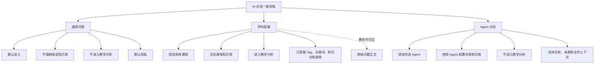

### 14.2 RAG 对话规则

1. 通用问答可不强制使用知识库，适合学习规划、操作指导和一般性问题。
2. 学科答疑必须明确课程上下文，优先使用课程知识库，相关提问信息进入教学分析，但教师只能看到聚合 Tag 和统计。
3. Agent 对话根据 Agent 配置使用一个或多个知识库，并遵守知识库优先级和可见范围。
4. 来源展示与回答同屏呈现，允许用户点击查看原文。
5. 无来源回答必须标注“该回答未基于知识库”。
6. 来源冲突时不得隐藏冲突来源，应解释差异和采用依据。
7. 数学推导、公式解释和代码解释同样需要来源；AI 推导内容需单独标注。

### 14.3 AI 对话三个工作空间原型

```text
+--------------------------------------------------------------------------------+
| AI 对话                                                                         |
+----------------------+---------------------------------------------------------+
| 历史会话             | [通用问答] [学科答疑: 机器学习] [Agent 对话]              |
| - 新对话             +------------------------------------+--------------------+
| - 梯度下降问题       | 对话区                             | 右侧信息            |
| - 正则化复习         |                                    |                    |
| - 决策树剪枝         | 用户: 什么是过拟合?                 | 当前空间: 学科答疑  |
|                      |                                    | 课程: 机器学习      |
|                      | AI: 过拟合是模型在训练集上...       | 知识库优先级:       |
|                      |                                    | 1. 课程讲义         |
|                      | 来源引用:                           | 2. 习题解析         |
|                      | [机器学习讲义.pdf p.24 相似度 0.91] | 3. 教师补充资料     |
|                      | [实验指导.docx 第 3 节 0.84]        |                    |
|                      |                                    | 提示: 学科答疑统计  |
|                      |                                    | 将用于教学分析      |
+----------------------+------------------------------------+--------------------+
| 输入: [请输入学习问题，支持粘贴公式和代码...]                         [发送] |
+--------------------------------------------------------------------------------+
```

## 15. 知识库与 RAG 系统

### 15.1 知识库分层

| 层级 | 典型内容 | 主要用途 | 可见范围 |
|---|---|---|---|
| 平台公共知识库 | 政策、平台说明、学科建设材料、通用规范 | 公共问答、管理治理 | 按角色或全局 |
| 课程知识库 | 教材、讲义、PPT、实验、习题、教师资料 | 学科答疑、备课、知识图谱 | 按课程授权 |
| 教学班知识库 | 班级资料、测试、任务、阶段报告 | 班级化教学和分析 | 指定教学班 |
| 个人知识库 | 学生笔记、错题、个人资料、教师备课资料 | 个人问答、个人 Agent | 个人私有 |
| Agent 专属知识库 | Agent 绑定资料、提示模板、专属文档 | Agent 对话和执行 | 由 Agent 权限决定 |

知识库和 Agent 应采用多对多关系，并支持知识库检索优先级。当前数据库已具备 KnowledgeBase、KnowledgeDocument、KnowledgeDocumentChunk、MessageSource 等基础实体；后续 Agent 与知识库多对多绑定需要补充独立关系表或等价结构。

### 15.2 文件格式

当前版本基础文件格式为 PDF 和 Word。代码层学生文档上传也出现 TXT、Markdown、DOCX 等处理入口，但产品验收优先保证 PDF 和 Word 质量。后续版本扩展扫描 PDF、OCR、图片、PPT、Excel、TXT、Markdown，以及更复杂的表格、公式和图像结构识别。

### 15.3 知识库与 RAG 流程图


### 15.4 RAG 溯源双栏页面原型

```text
+--------------------------------------------------------------------------------+
| RAG 溯源问答                                                                    |
+------------------------------------------+-------------------------------------+
| 左侧: 问答                               | 右侧: 来源文件                      |
|                                          |                                     |
| 用户: L2 正则化为什么能缓解过拟合?       | 文件: 机器学习课程讲义.pdf          |
|                                          | 知识库: 课程知识库                  |
| AI: L2 正则化通过惩罚较大的权重...       | 页码: 42                            |
|                                          | 相似度: 0.92                        |
| 来源:                                   |                                     |
| 1. 课程讲义.pdf p.42 0.92                | 原文片段:                           |
| 2. 实验指导.docx 第 5 节 0.86            | "...正则化项会限制参数规模..."      |
|                                          | 命中高亮: 正则化项 / 参数规模       |
| [有帮助] [有误] [无来源]                 |                                     |
|                                          | [查看上一页] [查看下一页] [打开原文] |
+------------------------------------------+-------------------------------------+
| 输入: [继续追问...]                                                        |
+--------------------------------------------------------------------------------+
```

## 16. Agent 创建与广场

### 16.1 Agent 生命周期图

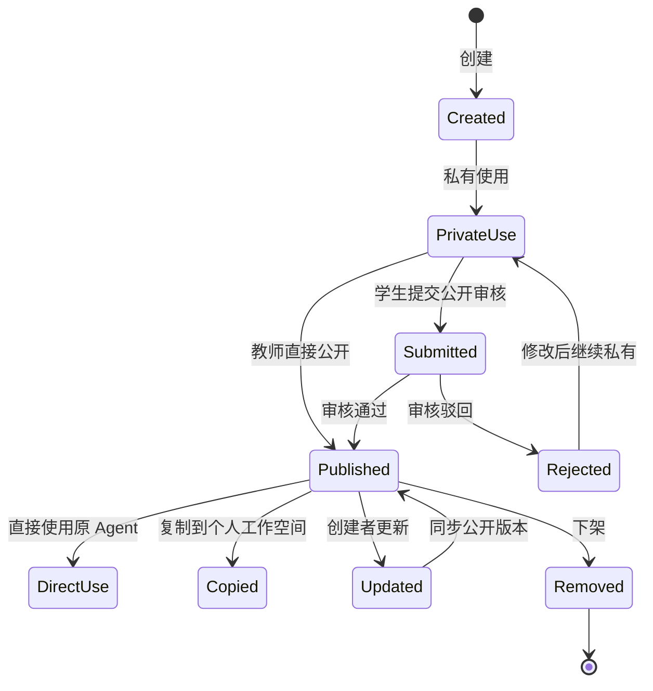

### 16.2 Agent 广场原型

```text
+--------------------------------------------------------------------------------+
| Agent 广场                                                                      |
+--------------------------------------------------------------------------------+
| 搜索: [课程问答 / 过拟合 / 机器学习...] [搜索]                                  |
| 分类: [全部] [课程问答] [概念讲解] [出题] [错题诊断] [教学助手] [视频讲解]       |
| 排序: [综合] [使用次数] [评分] [最新]      可见范围: [公开] [本校] [本课程]      |
+--------------------------------------------------------------------------------+
| +------------------+ +------------------+ +------------------+ +--------------+ |
| | 机器学习答疑     | | 决策树讲解       | | 错题诊断助手     | | 教案生成助手 | |
| | 类型: 课程问答   | | 类型: 概念讲解   | | 类型: 错题诊断   | | 类型: 教学   | |
| | 创建者: 张老师   | | 创建者: 李同学   | | 创建者: 王老师   | | 创建者: 陈老师| |
| | 知识库: 3 个     | | 知识库: 1 个     | | 知识库: 2 个     | | 知识库: 4 个 | |
| | 使用: 128 评分4.7| | 使用: 56 评分4.5 | | 使用: 91 评分4.8 | | 使用: 42     | |
| | [直接使用]       | | [直接使用]       | | [直接使用]       | | [直接使用]   | |
| | [复制] [收藏]    | | [复制] [收藏]    | | [复制] [收藏]    | | [复制]      | |
| +------------------+ +------------------+ +------------------+ +--------------+ |
+--------------------------------------------------------------------------------+
```

## 17. 学生自定义学习工作流

### 17.1 学习流示意图

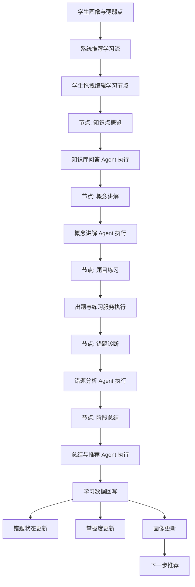

### 17.2 学生学习流编辑器原型

```text
+--------------------------------------------------------------------------------+
| 学习流编辑器: 机器学习 - 过拟合与正则化                                        |
+----------------------+------------------------------------+--------------------+
| 左侧节点库           | 中间拖拽画布                       | 右侧节点设置       |
|                      |                                    |                    |
| 基础节点             | [知识点概览] -> [概念讲解]         | 当前节点: 概念讲解 |
| - 学习目标设定       |        |                           | Agent: 概念讲解    |
| - 章节导入           |        v                           | 知识库: 课程讲义   |
| - 知识点概览         | [例题分析] -> [题目练习]           | 输出: 定义+例子    |
| - 概念讲解           |        |                           | 难度: 中等         |
|                      |        v                           | 时长: 10 分钟      |
| 训练节点             | [错题诊断] -> [相似题训练]         |                    |
| - 题目练习           |        |                           | [保存节点设置]     |
| - 随堂测试           |        v                           |                    |
| - 原题重做           | [阶段总结] -> [下一步推荐]         |                    |
| - 变式题训练         |                                    |                    |
+----------------------+------------------------------------+--------------------+
| [保存学习流] [预览执行] [开始学习]                                             |
+--------------------------------------------------------------------------------+
```

## 18. 教师多 Agent 备课系统

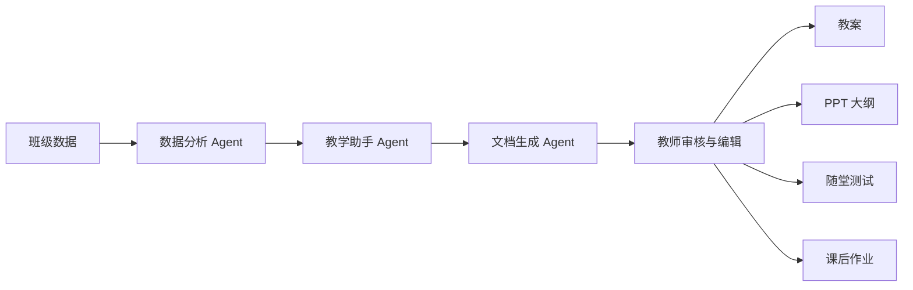

教师备课系统的核心不是替代教师，而是把班级学习数据转化为可编辑、可验证、可发布的教学材料初稿。发布前必须由教师确认。教师在整个过程中只看到聚合数据、分析标签和材料草稿，不查看学生学科答疑原文。

## 19. 课程与知识图谱

### 19.1 知识图谱生成与发布图

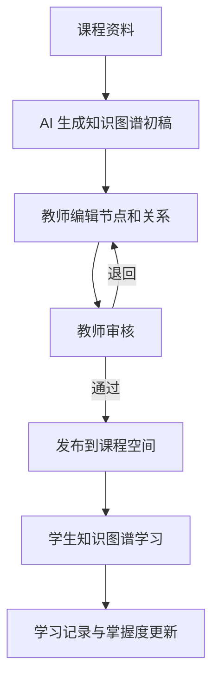

### 19.2 知识图谱学习页面原型

```text
+--------------------------------------------------------------------------------+
| 机器学习课程空间                                                                |
+-------------------------------+------------------------------------------------+
| 课程学习树                    | 知识点详情                                      |
|                               |                                                |
| 第一章 绪论                   | 当前知识点: 过拟合与欠拟合                     |
| 第二章 监督学习               | 掌握度: 58 待巩固                              |
|   - 线性回归       92 已掌握  | 推荐动作: 观看视频 -> 做 5 道相似题 -> 总结     |
|   - 逻辑回归       76 基本掌握|                                                |
|   - 过拟合与正则化 58 待巩固 | 右侧视频:                                      |
| 第三章 决策树                 | +--------------------------------------------+ |
|   - 信息增益       49 薄弱    | | 过拟合讲解视频                              | |
|   - 剪枝           52 待巩固  | | [播放] [全屏]                               | |
|                               | +--------------------------------------------+ |
|                               |                                                |
|                               | [加入学习流] [学科答疑] [开始练习]             |
+-------------------------------+------------------------------------------------+
```

## 20. 练习、考试与错题系统

### 20.1 错题状态与掌握度双层设计

单道错题状态和知识点掌握度是两个层次。错题已掌握不等于整个知识点已掌握；一个知识点可能包含多道题、多个任务和多次复习记录。

错题三态如下：

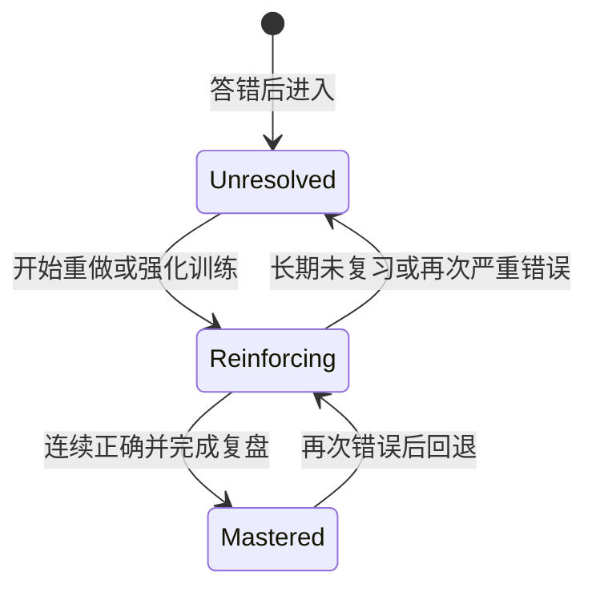

### 20.2 错题与练习规则

1. 题目支持单选、多选、填空、判断、简答和编程等类型。
2. 练习来源包括章节练习、推荐练习、教师任务、错题重做、AI 变式题和 AI 相似题。
3. 错题记录包括课程、章节、知识点、错误原因、状态、连续正确次数、最近复习时间和掌握时间。
4. 错误原因可由学生标注、系统推断或 AI 建议。
5. 题目维度错题分析向教师展示错误人数和错误答案，学生完整个人错题本不向教师开放。

## 21. 学生画像与掌握度

### 21.1 画像维度

学生画像包括综合画像和子画像。当前版本以学习能力画像为核心，科研能力和竞赛能力作为后续增强。学习画像至少展示课程学习进度、知识点掌握情况、测试成绩、错题分布、复习完成度、学习活跃度、班级相对位置、薄弱知识点和推荐学习内容。

### 21.2 掌握度公式

正式使用以下第一版掌握度计算公式：

```text
掌握度 =
0.30 × 练习得分
+ 0.25 × 测试得分
+ 0.15 × 复习完成度
+ 0.15 × 错题修复率
+ 0.15 × 教师修正项
```

规则说明：

1. 输出范围为 0 到 100。
2. 权重作为第一版正式规则，后续可配置和校准。
3. 教师修正需要记录原因。
4. 错题状态和知识点掌握度是两个层次。
5. 错题已掌握不等于整个知识点已掌握。

| 掌握度 | 状态 |
|---|---|
| 85-100 | 已掌握 |
| 70-84 | 基本掌握 |
| 50-69 | 待巩固 |
| 0-49 | 薄弱 |

## 22. 消息与通知

消息与通知需要支持系统通知、课程通知、教学班通知、任务通知、审核通知、Agent 发布与下架通知、文档解析通知、消息已读、未读数量、通知列表和导航栏提示。当前版本可使用数据库轮询。实时 WebSocket 通信作为后续增强。

## 23. 总体技术架构

### 23.1 当前项目代码核查摘要

当前项目根目录包含 `frontend/`、`backend/`、`docs/`、`storage/`、`scripts/` 和 `logs/`。根目录未发现 `package.json`，前后端分别维护依赖。

前端技术栈与结构：

| 项目 | 当前事实 |
|---|---|
| 构建工具 | Vite |
| 模块系统 | JavaScript ES Module |
| UI 技术 | HTML5、CSS3、原生 JavaScript |
| 请求 | Axios |
| 图表 | ECharts |
| Markdown 与公式 | Marked、DOMPurify、KaTeX |
| 知识图谱依赖 | Mind Elixir |
| 路由 | Hash Router，按角色守卫 |
| 页面 | 登录、注册、学生端、教师端、管理员端、AI 页面、Agent 页面目录 |

后端技术栈与结构：

| 项目 | 当前事实 |
|---|---|
| 运行环境 | Node.js |
| Web 框架 | Express 5 |
| ORM | Prisma 7 |
| 数据库 | MySQL |
| 认证 | JWT、Refresh Token、bcryptjs、Session 记录 |
| 文件上传 | multer，本地 `storage/uploads` |
| 文档解析 | pdf-parse、mammoth，TXT/Markdown 直接读取 |
| AI 调用 | DeepSeek OpenAI SDK、OpenAI 兼容调用、AI 调用日志 |
| AI 预留 | Dify、RAG、Agent、Agent Market、多模型 Provider、Qdrant 配置 |
| 路由 | `/api/auth`、`/api/student`、`/api/practice`、`/api/teacher`、`/api/admin`、`/api/ai-chat` |

AI 与工作流：

1. DeepSeek 学科答疑服务支持多轮会话和 SSE 流式返回。
2. AI 题目生成、错题变式题、相似题、错误原因分析已有服务逻辑。
3. Dify、RAG、Agent 和 Agent 广场目录已作为模块预留，需按产品目标完善路由、服务、数据结构和前端页面挂载。
4. 教师 AI 生题、摘要、视频生成和学习分析路由当前以占位方式存在，正式产品目标要求形成教师多 Agent 备课闭环。

### 23.2 总体架构说明

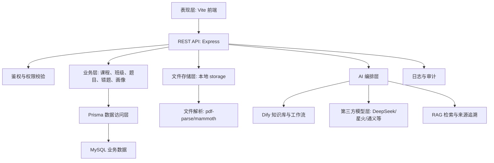

当前主要技术栈不得擅自替换为 NestJS、Fastify、Milvus、pgvector 或 Redis。上述技术可作为未来演进建议，不能在没有真实迁移的情况下替换当前架构事实。

## 24. 关键技术流程

### 24.1 文档上传和解析流程

用户选择知识库或课程空间上传文件。系统进行登录校验、角色校验、对象权限校验、文件大小和类型校验。文件保存到本地存储后创建 KnowledgeDocument 记录，状态为 uploaded。用户或任务触发解析后，系统读取文件，PDF 使用 pdf-parse，DOCX 使用 mammoth，TXT/Markdown 直接读取；清洗文本后按段落和字符长度分块，写入 KnowledgeDocumentChunk，并更新解析状态。解析失败写入 error_message 并提供重试入口。

### 24.2 知识库构建流程

知识库创建后绑定层级、课程、教学班或个人。文档解析成功后生成块数据。当前产品目标要求继续向 Dify 或向量库写入索引，并记录 embedding_id、vector_store_type 或 dify_segment_id。删除文档时需要同步删除块、来源索引和外部向量索引。

### 24.3 Agent 创建流程

用户填写 Agent 名称、描述、类型，选择多个知识库并设置优先级，选择私有、课程内共享、教学班共享或公开。系统校验知识库状态和权限，创建 Agent 配置，必要时调用 Dify 创建 App 或 Workflow，保存 Dify App、Workflow、Dataset 等关联信息。学生公开 Agent 进入审核，教师公开 Agent 直接进入广场。

### 24.4 RAG 对话流程

用户提问后，系统识别工作空间和意图，按用户角色、课程、教学班、知识库优先级和 Agent 配置过滤候选知识库，调用 Dify 或自研检索召回片段，组装上下文和来源元数据，调用大模型生成回答，并把 MessageSource 与回答一起保存。前端同步展示回答、来源和原文入口。

### 24.5 来源追溯流程

系统为每条知识性回答保存 document_id、chunk_id、document_title、page_number、chunk_text 和 similarity。用户点击来源时，前端请求来源详情，后端校验用户是否有权查看该文档或 Agent 授权范围，返回片段、页码和预览信息。公开 Agent 使用者可查看引用原文，但不可下载、修改或删除原始文件。

### 24.6 学生学习流执行流程

学生选择或创建学习流后，系统生成执行任务。每个节点按类型调用对应 Agent 或业务服务。概念讲解节点调用学科问答或概念讲解 Agent；练习节点调用题库和练习服务；错题诊断节点调用错题分析；总结推荐节点调用画像和推荐服务。每个节点结束后写入节点状态、学习记录、答题记录、错题状态和掌握度变化。

### 24.7 教师多 Agent 备课流程

教师选择课程、教学班、时间范围和输出内容。数据分析 Agent 聚合高频 Tag、知识点提问人数、章节错误率、题目错误人数、学习时长、登录频率和任务完成情况。教学助手 Agent 生成教学目标、重点难点、复习清单和课堂活动建议。文档生成 Agent 输出教案、PPT 大纲、随堂测试和课后作业。教师审核编辑后才能发布。

### 24.8 错题生成和训练流程

学生作答后系统记录 AnswerRecord。判错题目自动进入 WrongQuestion。AI 可分析错误原因。学生在错题本中选择原题重做、变式题或相似题训练。系统创建练习会话，生成或读取题目，完成判分后更新连续正确次数、复习状态、掌握时间和知识点掌握度。

### 24.9 画像计算流程

系统从练习得分、测试得分、复习完成度、错题修复率和教师修正项计算知识点掌握度。画像服务按课程聚合进度、掌握度、测试、错题、活跃度和问答行为，生成 StudentPortrait 和快照。推荐系统基于画像输出下一步知识点、题目、视频、学习路线和复习计划。

### 24.10 知识图谱生成和发布流程

系统从课程资料和教师维护的章节知识点生成图谱初稿。教师编辑节点、关系、章节归属、难度和排序。教师审核通过后发布到学生课程空间。学生学习图谱节点时产生学习记录并影响掌握度。

## 25. 数据需求

### 25.1 核心实体

| 领域 | 关键实体 |
|---|---|
| 用户认证 | User、UserProfile、RefreshToken、AuthSession |
| 班级课程 | AdminClass、Course、CourseTeacherRelation、TeachingClass、StudentCourseEnrollment |
| 课程知识 | Chapter、KnowledgePoint、KnowledgePointAlias |
| 知识库 | KnowledgeBase、KnowledgeDocument、KnowledgeDocumentChunk、KnowledgeDocumentReview |
| 对话与来源 | AiConversation、AiMessage、ChatConversation、ChatMessage、MessageSource、FeedbackRecord |
| 提问分析 | StudentQuestionRecord、QuestionAnalysisRecord、QuestionKeyword、QuestionConfusionTag、QuestionKnowledgePointMapping |
| 题库任务 | QuestionBank、Question、QuestionOption、LearningTask、TaskSubmission、AnswerRecord |
| 错题训练 | WrongQuestion、WrongQuestionTag、WrongQuestionCollection、AiGenerationJob |
| 画像推荐 | StudyRecord、StudentMasteryRecord、StudentPortrait、RecommendationRecord、LearningPath、ReviewPlan |
| AI 与日志 | AiModelConfig、AiAgentConfig、AgentRunRecord、AiCallLog、SafetyCheckRecord、OperationLog |
| 视频与通知 | VideoResource、VideoGenerationTask、Notification、SystemConfig |

### 25.2 需要补充或强化的数据结构

为完整支撑目标产品，建议在后续数据库迁移中补充：

1. UserAgent 或 Agent 实体，用于区分用户自建 Agent、系统 Agent、Dify Agent 和广场 Agent。
2. AgentKnowledgeBaseRelation，用于支持一个 Agent 关联多个知识库和优先级。
3. AgentFavorite、AgentRating、AgentCopyRecord、AgentReviewRecord，用于广场收藏、评分、复制和审核。
4. LearningFlow、LearningFlowNode、LearningFlowRun、LearningFlowNodeRun，用于学生拖拽学习流和节点执行状态。
5. KnowledgeGraphReview 或发布状态字段，用于知识图谱教师审核与发布记录。
6. TeachingClassTeacherRelation，用于明确一个教学班由多名教师负责的关系。

## 26. 权限、安全与隐私

### 26.1 安全需求

1. 密码必须使用 bcryptjs 等方式加密存储，不存明文。
2. API 使用 JWT 鉴权，Refresh Token 使用 HttpOnly Cookie 或等价安全机制。
3. 后端每个对象级接口必须校验用户是否有该课程、教学班、知识库、任务或 Agent 的权限。
4. 文件上传必须校验大小、扩展名、MIME 类型和存储路径。
5. 数据访问通过 Prisma 等结构化方式完成，避免 SQL 注入。
6. Markdown 渲染必须配合 DOMPurify 或等价方式防 XSS。
7. Prompt Injection 防护应覆盖用户输入、知识库片段、工具调用和系统 Prompt。
8. API Key 只保存在后端环境变量或加密配置中，前端不得暴露。
9. 日志应脱敏，避免写入完整密钥、密码和学生私密正文。
10. 公开 Agent、公开知识库和 AI 生成内容需要治理、审核和下架机制。

### 26.2 隐私需求

1. 通用问答不进入教学分析。
2. Agent 对话不进入教学分析。
3. 学科答疑只提取 Tag、关键词、知识点、提问人数和统计趋势。
4. 教师不能查看学生学科答疑原文。
5. 管理员不默认查看学生私密内容。
6. 画像计算要可解释，学生可以看到分数来源和推荐依据。
7. 自动推荐应提供依据说明，后续支持关闭个性化推荐或切换通用推荐。
8. 学生被移出教学班后，该教学班内历史学习记录按当前业务规则不继续保留。

### 26.3 AI 治理需求

1. AI 生成的教学方案、试题、报告和视频需要标识为 AI 生成或 AI 辅助生成。
2. 公开发布前必须有人类审核，教师是教学材料发布的最终责任人。
3. 无来源回答必须醒目标注。
4. 生成内容涉及图片、音频、视频或可导出文本时，应预留显式标识和文件元数据隐式标识能力。
5. 模型调用要记录 provider、model、用途、耗时、状态、token 和错误信息。

## 27. 非功能需求

### 27.1 性能

| 场景 | 目标 |
|---|---|
| 普通页面响应 | 核心页面首屏在常规校园网络下可接受，接口应分页和懒加载 |
| AI 首字响应 | 流式对话应尽量在 3 到 8 秒内返回首字，受模型服务影响可提示排队 |
| 流式返回 | SSE 或等价机制持续输出，支持中断和失败保存 |
| 文件上传 | 当前单文件建议上限 20MB，上传过程显示进度和错误 |
| 文件解析 | 小型 PDF 或 Word 应有明确状态；较大文件异步处理 |
| 多 Agent 工作流 | 教师备课在 15 到 60 秒内给出首版产物或阶段结果 |
| 图表加载 | 看板按时间和教学班聚合，避免一次加载全量明细 |
| 并发与超时 | AI、解析和生成任务设置超时、重试和降级 |

### 27.2 可用性

系统需要覆盖空状态、加载状态、错误状态、超时、重试、二次确认、骨架屏、进度提示、文件解析状态、Agent 执行状态和 AI 生成状态。删除课程、教学班、知识库、Agent、任务和文件均需二次确认，并说明影响范围。

### 27.3 可维护性

前后端保持模块化。AI 服务、Dify 调用、RAG 检索、文件解析、模型配置和日志记录应统一封装。模型、Embedding、Dify App、向量库和文件存储应可替换。数据库迁移和环境变量要有文档说明。接口统一返回 `{ code, message, data }`。

### 27.4 兼容性

优先支持 Chromium 内核浏览器，支持常见桌面分辨率。核心页面应响应式适配。部署环境应适配校园局域网和普通云主机。

## 28. 页面与交互要求

### 28.1 页面总原则

1. 首页进入后应是工作台，不是营销页。
2. 学生端突出课程、学习流、练习、错题、画像、推荐和 Agent。
3. 教师端突出课程、教学班、数据看板、备课、题目、任务和通知。
4. 管理员端突出治理、审核、配置、日志和监控。
5. 对话、RAG 溯源、学习流编辑器、Agent 广场、知识图谱和教师看板是答辩重点页面。
6. 页面应避免装饰性堆砌，突出可操作状态、来源依据和下一步动作。

### 28.2 教师班级数据看板原型

```text
+--------------------------------------------------------------------------------+
| 教师班级数据看板: 机器学习 2026 春 1 班                                        |
+-------------------------+-------------------------+----------------------------+
| 本周活跃学生: 42        | 平均进度: 68%           | 任务完成率: 74%            |
+-------------------------+-------------------------+----------------------------+
| 高频 Tag                | 薄弱知识点排行          | 题目错误人数               |
| 1. 过拟合  38 次        | 1. 正则化      18 人    | Q12 决策树剪枝     21 人   |
| 2. 梯度下降 26 次       | 2. 信息增益    15 人    | Q08 L2 正则化      17 人   |
| 3. 决策树  22 次        | 3. 模型评估    13 人    | Q05 交叉验证       12 人   |
+-------------------------+-------------------------+----------------------------+
| 学习时长趋势                                                                     |
| [折线图: 最近 7 天人均学习时长]                                                  |
+--------------------------------------------------------------------------------+
| AI 教学建议                                                                       |
| - 下节课建议先复习过拟合、正则化和交叉验证                                       |
| - 随堂测试建议加入 3 道判断题、2 道选择题和 1 道简答题                           |
|                                                                                |
| [一键生成教学方案] [生成 PPT 大纲] [生成随堂测试] [发布复习任务]                 |
+--------------------------------------------------------------------------------+
```

## 29. 当前版本、下一版本与远期规划

### 29.1 当前版本

当前版本产品目标包含三角色系统、登录注册、课程系统、行政班和教学班、学习进度、课程知识图谱、PDF 和 Word 知识库、RAG 来源追溯、通用问答、学科答疑、Agent 对话三个空间、No-Code Agent 创建、多知识库优先级、Agent 广场、Agent 发布、下架、直接使用、复制、收藏、匿名评分、学生拖拽自定义学习工作流、学生多 Agent 学习执行、教师固定多 Agent 备课流程、练习和答题、错题强化、学生画像、教师看板、教师题目维度错题分析、通知和管理员治理。

### 29.2 下一版本

下一版本增强扫描 PDF 和 OCR、PPT、Excel、图片解析、更强的公式、代码和表格解析、更成熟的视频讲解生成、科研辅助、文献脉络、学习报告自动导出、Word、PDF、PPT 导出、更复杂的消息系统、PWA、更多 Agent 模板、跨课程知识关联、推荐算法优化和多模型路由增强。

### 29.3 远期版本

远期版本扩展通用底层 Agent 拖拽编排、条件分支和循环节点、工具调用节点、自定义 API、多学校和多租户、校级知识中台、多学科知识图谱融合、LMS 对接、模型微调、校内统一认证、智能体生态排行榜、更复杂的科研工作流和移动端生态。

### 29.4 版本路线图

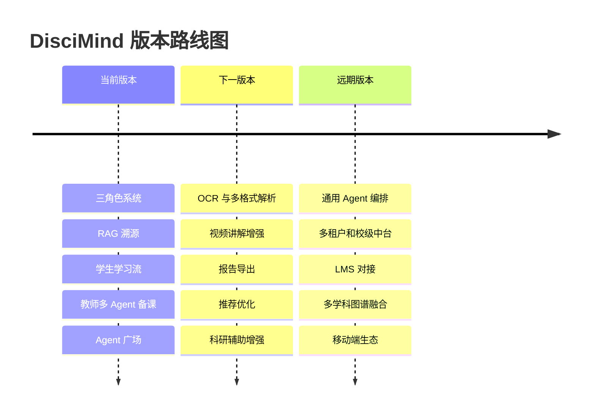

## 30. 验收标准

| 模块 | 验收标准 |
|---|---|
| 登录注册 | 学生和教师可注册，三角色可登录，登录后按角色跳转，禁用账号不可登录 |
| 角色跳转 | 学生、教师、管理员访问无权限页面时自动回到本角色首页 |
| 行政班与教学班 | 学生属于行政班，可加入多个教学班；教学班可包含多个行政班学生 |
| 课程 | 课程可绑定多名教师，可创建多个教学班、章节和知识点 |
| 知识库 | 学生、教师按权限创建知识库，上传 PDF 或 Word 后展示上传、解析和就绪状态 |
| 文档解析 | 解析失败时显示失败原因并提供重试入口 |
| Agent 创建 | 用户可填写名称、类型、多个知识库和优先级创建 Agent |
| Agent 多知识库 | Agent 可配置多个知识库并按优先级检索 |
| Agent 广场 | 可搜索、筛选、直接使用、复制、收藏、评分和查看创建者 |
| RAG 来源 | 回答展示文件名、页码、片段、相似度和知识库名称 |
| 无来源提示 | 无可靠来源时明确标注“该回答未基于知识库” |
| 三个 AI 工作空间 | 通用问答、学科答疑、Agent 对话边界清晰 |
| 学生学习流拖拽 | 学生可拖拽学习节点、保存、预览和开始执行 |
| Agent 节点执行 | 节点执行有状态，失败可重试，结果可查看 |
| 学习流数据回写 | 练习、错题、进度和画像随执行结果更新 |
| 教师多 Agent 备课 | 教师选择课程和教学班后生成教学方案、PPT 大纲、测试和作业草稿 |
| 教师审核 | AI 生成材料必须经教师确认才能发布 |
| 知识图谱 | AI 初稿经教师编辑审核后发布给学生 |
| 练习答题 | 支持练习会话、答题保存、提交判分和结果页 |
| 错题状态 | 错题支持未解决、强化中、已掌握状态，重复错误可回退 |
| 学生画像 | 掌握度公式可解释，显示薄弱点和推荐内容 |
| 教师题目分析 | 教师可按题目查看错误人数和错误答案，不看完整个人错题本 |
| 通知 | 通知有未读数、列表和标记已读 |
| 管理员审核 | 管理员可审核公开知识库和学生公开 Agent |
| 权限和隐私 | 教师不能查看学生学科答疑原文，管理员不默认查看私密正文 |
| 错误和异常处理 | 上传失败、AI 超时、无数据、无权限均有明确提示和恢复入口 |

## 31. 风险与应对

| 风险 | 影响 | 应对 |
|---|---|---|
| Dify 接入不稳定 | RAG 和 Agent 工作流受阻 | 封装重试、超时和降级，保留自研轻量服务接口 |
| 文档解析质量不足 | 来源召回不准 | 优先保证 PDF 和 Word，失败可重试，后续引入 OCR 和结构解析 |
| RAG 无来源或来源冲突 | 用户信任降低 | 强制无来源提示，冲突来源并列展示 |
| 学生隐私泄露 | 教学伦理和合规风险 | 学科答疑只入聚合分析，教师不可见原文，日志脱敏 |
| 学习流范围过大 | 当前版本交付风险 | 当前只做学习节点拖拽，不做通用底层 Agent 编排 |
| 教师生成材料质量不稳 | 发布内容风险 | 教师人工审核为发布前置条件 |
| 15 天工期紧张 | 交付延期 | 聚焦演示闭环，Dify/RAG、学习流和教师备课优先 |
| 模型接口额度或延迟 | AI 功能不可用 | 配置主备模型、Mock 或模板降级，记录调用日志 |
| 数据模型缺少 Agent 多对多 | 广场和多知识库受限 | 优先补充 Agent 与知识库关系表 |

## 32. 15 天实施计划

### 32.1 实施前判断

根据当前代码，基础三端页面、课程、教学班、题目、练习、错题、画像、通知、文档上传解析、DeepSeek 对话和 AI 题目生成已有较多结构；风险最高的是 Dify/RAG 真正联调、Agent 广场路由挂载和数据结构补齐、学生学习流编辑器与执行器、教师多 Agent 备课闭环。可并行任务主要是前端页面、后端数据结构、Dify/RAG 服务和演示数据准备；强依赖任务包括数据库迁移先于接口联调，Dify 联通先于 RAG 溯源验收，学习流节点执行先于画像回写演示。

### 32.2 每日计划

| 天数 | 里程碑 | 成员一: 后端、数据库、权限和 Dify 核心 | 成员二: 前端核心页面和 Agent 对话 | 成员三: 课程、题目、错题和学习流全栈 | 成员四: ECharts、知识图谱、画像、教师看板和演示 |
|---|---|---|---|---|---|
| Day 1 | 范围锁定与数据迁移设计 | 梳理现有 Schema，设计 Agent、Agent-KB、LearningFlow 迁移 | 梳理路由和页面缺口，确定导航入口 | 梳理题目、错题、练习和学习流节点清单 | 梳理图谱、画像、看板指标和演示数据 |
| Day 2 | 数据库迁移 | 完成迁移脚本、生成 Prisma Client、补权限校验点 | 搭建 Agent 广场、我的 Agent、创建页壳 | 设计学习流节点模型和执行状态 | 设计教师看板图表组件和数据字段 |
| Day 3 | Dify 与 RAG 服务骨架 | 实现 Dify service、RAG service、来源保存结构 | 对话页三工作空间切换和来源卡片 | 学习流编辑器画布基础拖拽 | 知识图谱页面和视频入口对齐 |
| Day 4 | 文档索引与来源追溯 | 文档解析后接 Dify 或向量索引，保存来源 | RAG 双栏溯源页面 | 节点库、节点设置和保存 | 画像掌握度图表和推荐卡片 |
| Day 5 | Agent 创建闭环 | Agent CRUD、多知识库优先级、权限 | Agent 创建页、知识库选择和排序 | 学习流保存接口与模板 | 教师看板接口对接 |
| Day 6 | Agent 广场闭环 | 广场列表、详情、收藏、评分、直接使用、复制接口 | 广场卡片、详情页、我的 Agent | 学习流执行器后端第一版 | 高频 Tag、薄弱点、错误排行图表 |
| Day 7 | RAG 联调里程碑 | Dify/RAG 对话、无来源提示、反馈记录 | 三工作空间对话联调 | 练习和错题节点接入学习流 | 图谱发布状态和学生学习入口 |
| Day 8 | 学习流里程碑 | 学习流运行记录、AgentRunRecord 关联 | 学习流执行进度 UI | 题目练习、错题诊断、变式训练节点 | 画像回写和推荐联动 |
| Day 9 | 教师备课服务 | 数据分析 Agent、教学助手 Agent、文档生成 Agent 接口 | 教师备课执行过程页面 | 备课生成的测试题接题库 | 教师看板到备课入口联动 |
| Day 10 | 教师工作流里程碑 | 教师审核发布、任务和通知联动 | 教案、PPT 大纲、测试草稿编辑页 | 任务发布和答题链路联调 | 看板和备课结果演示优化 |
| Day 11 | 管理员治理 | Agent 审核、知识库审核、模型配置和日志补齐 | 管理端审核页面补交互 | 学生公开 Agent 审核状态联动 | 管理员看板异常和趋势图 |
| Day 12 | 全链路联调 | 修复权限、会话、接口异常 | 修复页面路由、空状态、错误态 | 学习流到错题和画像回写测试 | 看板指标口径和图表校验 |
| Day 13 | 演示数据准备 | 准备种子数据、课程资料、Dify 配置 | 准备演示账号和页面路径 | 准备错题、学习流模板和练习题 | 准备看板、图谱、画像数据 |
| Day 14 | 部署与测试 | 部署后端、数据库迁移、环境变量核验 | 前端构建和部署验证 | 端到端测试、异常用例 | 演示脚本、截图和备用材料 |
| Day 15 | 答辩演练与风险缓冲 | 修复最后阻塞问题、导出接口说明 | UI 打磨、答辩动线确认 | 演示操作演练和备份流程 | PPT、演示数据和讲稿终稿 |

## 33. 四人团队分工

| 成员 | 主职责 | 关键交付 | 主要风险 |
|---|---|---|---|
| 成员一 | 后端、数据库、权限、Dify/RAG 核心 | 数据库迁移、Dify/RAG 服务、来源追溯、权限校验、模型配置 | Dify 接入、来源追溯、对象级权限 |
| 成员二 | 前端核心页面、AI 对话、Agent 广场 | 三工作空间对话、Agent 创建、Agent 广场、我的 Agent、RAG 双栏页面 | 页面路由、流式对话、复杂交互 |
| 成员三 | 课程、题目、错题、学习流全栈 | 学习流编辑器、节点执行、练习错题联动、任务发布 | 学习流状态复杂、错题回写 |
| 成员四 | ECharts、知识图谱、画像、教师看板、演示 | 知识图谱、画像雷达图、教师看板、演示数据和答辩材料 | 指标口径、图表可读性、演示稳定 |

协作规则：

1. Day 1 到 Day 2 优先统一数据结构和接口契约。
2. Day 3 到 Day 7 优先完成 RAG 和 Agent 核心闭环。
3. Day 8 到 Day 10 优先完成学习流和教师备课两个创新闭环。
4. Day 11 到 Day 15 集中处理管理员治理、测试、部署和答辩。
5. 每天固定一次接口联调和一次演示链路检查。

## 34. 优势与价值

### 34.1 个性化学习优势

学生自定义学习流让学习顺序可自定义，Agent 能力可组合，画像、错题和知识点掌握度直接参与流程。学生不是只看系统推荐，而是可以在推荐基础上编辑自己的路径。学习结果再次更新画像和错题状态，下一次推荐会随之调整。这解决了传统系统统一路径、统一节奏和个体差异无法进入学习流程的问题。

### 34.2 可信 AI 优势

RAG 溯源让回答有来源、能看原文、能定位页码、能识别无来源回答并处理冲突来源。学生可以验证答案，教师可以判断是否采纳。数学推导、代码解释和学科定义都被纳入来源要求，显著降低模型幻觉带来的教学风险。

### 34.3 Agent 低门槛和共享生态优势

Agent 广场让学生无需编程即可选择知识库创建个人 Agent，也让教师可以公开高质量课程 Agent。直接使用和复制两种模式兼顾资源复用与个人定制。收藏、评分、搜索、筛选和治理机制使优质教学能力能够沉淀和传播，降低师生构建 Agent 的门槛。

## 35. 附录

### 35.1 术语表

| 术语 | 说明 |
|---|---|
| RAG | 检索增强生成，通过知识库检索为模型回答提供依据 |
| Agent | 面向特定学习、教学或分析任务的智能体 |
| 学习流 | 学生按学习节点编排的个性化流程 |
| 行政班 | 学生基础组织关系，如学院、专业、年级、班级 |
| 教学班 | 某课程某学期的教学组织，可包含多个行政班学生 |
| 学科答疑 | 绑定课程知识库、进入教学分析聚合的 AI 对话空间 |
| 通用问答 | 默认隐私、不进入教学分析的 AI 对话空间 |
| Agent 对话 | 与选定 Agent 绑定、不进入教学分析的对话空间 |

### 35.2 政策与治理参考链接

1. 教育部：《教育强国建设规划纲要（2024—2035年）》  
   https://www.moe.gov.cn/jyb_xxgk/moe_1777/moe_1778/202501/t20250119_1176193.html
2. 教育部等九部门：《关于加快推进教育数字化的意见》  
   https://www.moe.gov.cn/srcsite/A01/s7048/202504/t20250416_1187476.html
3. 教育部等五部门：《“人工智能+教育”行动计划》  
   https://www.moe.gov.cn/srcsite/A16/s3342/202604/t20260410_1433240.html
4. 国家网信办等七部门：《生成式人工智能服务管理暂行办法》  
   https://www.cac.gov.cn/2023-07/13/c_1690898327029107.htm
5. 国家网信办等四部门：《人工智能生成合成内容标识办法》  
   https://www.cac.gov.cn/2025-03/14/c_1743654684782215.htm
6. 全国人大网：《中华人民共和国个人信息保护法》  
   https://www.cac.gov.cn/2021-08/20/c_1631050028355286.htm
7. UNESCO：Guidance for generative AI in education and research  
   https://www.unesco.org/en/articles/guidance-generative-ai-education-and-research
8. NIST：AI Risk Management Framework  
   https://www.nist.gov/itl/ai-risk-management-framework
9. NIST AIRC：AI Risks and Trustworthiness  
   https://airc.nist.gov/airmf-resources/airmf/3-sec-characteristics/

### 35.3 生成自检

| 检查项 | 结果 |
|---|---|
| 已阅读五份需求文件并统一术语 | 通过 |
| 已检查当前项目目录、前端、后端、Prisma、路由、服务、模块和文档 | 通过 |
| 已按当前真实技术栈描述 | 通过 |
| 已围绕四个核心痛点展开 | 通过 |
| 已突出学生学习流、教师多 Agent 备课、RAG 溯源和 Agent 广场 | 通过 |
| 已区分通用问答、学科答疑和 Agent 对话 | 通过 |
| 已说明教师不能查看学生提问原文 | 通过 |
| 已区分行政班和教学班 | 通过 |
| 已包含 Agent 多知识库优先级、审核、直接使用和复制规则 | 通过 |
| 已包含无来源回答提示和来源冲突处理 | 通过 |
| 已包含错题三态和掌握度公式 | 通过 |
| 已包含知识图谱教师审核发布流程 | 通过 |
| 已按共有、学生端、教师端、管理员端组织功能 | 通过 |
| 已包含要求的 Mermaid 图和 ASCII 原型 | 通过 |
| 已包含当前、下一、远期版本规划 | 通过 |
| 已包含 15 天实施计划和四人分工 | 通过 |
